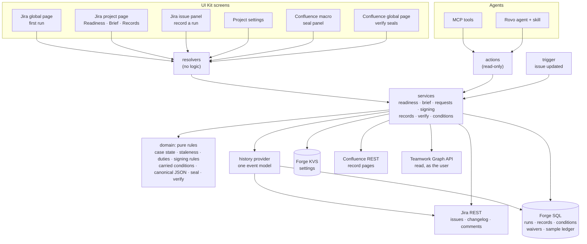

# Fair Copy — know what you are signing

A Forge app for Jira and Confluence. Codegeist 2026, Apps for Specialized Industries. Solo entry by Sangnan Wu.

- **Demo video (3:39):** https://youtu.be/VS40sUNnzDY
- **Install:** [installation link](https://developer.atlassian.com/console/install/7e48a9b3-f2d8-4c33-92a1-af79274e99c9?signature=AYABeHJ%2BN3T%2Bf%2FkQyBWB0SHon6kAAAADAAdhd3Mta21zAEthcm46YXdzOmttczp1cy13ZXN0LTI6NzA5NTg3ODM1MjQzOmtleS83MDVlZDY3MC1mNTdjLTQxYjUtOWY5Yi1lM2YyZGNjMTQ2ZTcAuAECAQB4CxqLTo9l4lqXuFjNim1xJM%2Bp%2F3TVP9xHS2BrU5DRRucBnIsX33Amt6hRnvpOqroWxgAAAH4wfAYJKoZIhvcNAQcGoG8wbQIBADBoBgkqhkiG9w0BBwEwHgYJYIZIAWUDBAEuMBEEDIQpWBYWexTNS%2Bn%2FxgIBEIA7KZgIwKd84IfE9pRQoquVD4JQB4KDJcmgBXs1DDIz6FUQDSjNn9mptiVG5XlnGH1WknHEwywwu0B1xvUAB2F3cy1rbXMAS2Fybjphd3M6a21zOmV1LXdlc3QtMTo3MDk1ODc4MzUyNDM6a2V5LzQ2MzBjZTZiLTAwYzMtNGRlMi04NzdiLTYyN2UyMDYwZTVjYwC4AQICAHi9bVMAkme4qVQX1fQHo6ePw3H40A7cGfz7yrmSfBWMXgEfK5HcmVrYiIriQq%2B0HyniAAAAfjB8BgkqhkiG9w0BBwagbzBtAgEAMGgGCSqGSIb3DQEHATAeBglghkgBZQMEAS4wEQQMzefAAcaEbWNP8%2BsnAgEQgDudDeQDAENZtjdLidAVy4OYBuo08oO4ydoaWbyxb9pW27qVHXhX9Al5Qyv5X6dHgGE0HurMAEQNjdG9yQAHYXdzLWttcwBLYXJuOmF3czprbXM6dXMtZWFzdC0xOjcwOTU4NzgzNTI0MzprZXkvNmMxMjBiYTAtNGNkNS00OTg1LWI4MmUtNDBhMDQ5NTJjYzU3ALgBAgIAeDYASx0XCjkny4iLV6vz%2BKtEGSGT6kdt0QRpkn6D%2FlVEAY3gjJgaqs6OK3Kg1FXUwhcAAAB%2BMHwGCSqGSIb3DQEHBqBvMG0CAQAwaAYJKoZIhvcNAQcBMB4GCWCGSAFlAwQBLjARBAwWe4eAR1Bd2f%2FyX9ACARCAO9Fb%2BoiWKiX8PFKYBkCse2xDOU1DJGe13MvQu463DOg%2FcxzNkH7I3mk%2B35KRfgfCJpt5jRS8vs3pudjzAgAAAAAMAAAQAAAAAAAAAAAAAAAAAPaLLvBNBpv2bAogZ8vZxBH%2F%2F%2F%2F%2FAAAAAQAAAAAAAAAAAAAAAQAAADJMSG8S%2BToW68aZY85ftJCVVg8bjD0l5YMs2IJNs6BEbJzieuE48LINIPKoIwCLeHEX1Pnkrt8LEgx4R%2FZRtfLinCs%3D&product=jira&product=confluence) (production; Jira, with Confluence ticked in the install dialog)

**The problem.** The person who signs off a release is usually senior, did not build or test it, and is handed a sheet
that says "11 of 12 passed". The sheet leaves out that a requirement was reworded after its tests passed, that the
signer worked on the release, and what was promised at the last sign-off. They are accountable, and they sign blind.

**What it does.** Fair Copy gives them the rest before they sign, and keeps what they decide:

- **what changed after testing** — a pass stops counting when the requirement is edited or a defect is reopened;
- **who did what** — taken from Jira history; an approver who worked on the release is not independent;
- **what was promised last time** — conditions attached to a sign-off are the first thing the next release says,
  until someone confirms they are met;
- **a tamper-evident record** — a Confluence page sealed with SHA-256 and linked to the record of the release before.
  Edit it, and the page says which field changed.

It runs entirely on Atlassian Forge: no external network access, no LLM. Three read-only MCP tools and a Rovo agent
give the same facts to pipelines and agents; every screen works without them.

It is not an e-signature, not a test-management tool, and it does not make anyone compliant with anything.
All sample data is fictional.

## Install

You need a site with Jira and Confluence and an account that is an admin of the site. Rovo is optional. About ten
minutes; no command line, no API token, no settings.

1. Open the [installation link](https://developer.atlassian.com/console/install/7e48a9b3-f2d8-4c33-92a1-af79274e99c9?signature=AYABeHJ%2BN3T%2Bf%2FkQyBWB0SHon6kAAAADAAdhd3Mta21zAEthcm46YXdzOmttczp1cy13ZXN0LTI6NzA5NTg3ODM1MjQzOmtleS83MDVlZDY3MC1mNTdjLTQxYjUtOWY5Yi1lM2YyZGNjMTQ2ZTcAuAECAQB4CxqLTo9l4lqXuFjNim1xJM%2Bp%2F3TVP9xHS2BrU5DRRucBnIsX33Amt6hRnvpOqroWxgAAAH4wfAYJKoZIhvcNAQcGoG8wbQIBADBoBgkqhkiG9w0BBwEwHgYJYIZIAWUDBAEuMBEEDIQpWBYWexTNS%2Bn%2FxgIBEIA7KZgIwKd84IfE9pRQoquVD4JQB4KDJcmgBXs1DDIz6FUQDSjNn9mptiVG5XlnGH1WknHEwywwu0B1xvUAB2F3cy1rbXMAS2Fybjphd3M6a21zOmV1LXdlc3QtMTo3MDk1ODc4MzUyNDM6a2V5LzQ2MzBjZTZiLTAwYzMtNGRlMi04NzdiLTYyN2UyMDYwZTVjYwC4AQICAHi9bVMAkme4qVQX1fQHo6ePw3H40A7cGfz7yrmSfBWMXgEfK5HcmVrYiIriQq%2B0HyniAAAAfjB8BgkqhkiG9w0BBwagbzBtAgEAMGgGCSqGSIb3DQEHATAeBglghkgBZQMEAS4wEQQMzefAAcaEbWNP8%2BsnAgEQgDudDeQDAENZtjdLidAVy4OYBuo08oO4ydoaWbyxb9pW27qVHXhX9Al5Qyv5X6dHgGE0HurMAEQNjdG9yQAHYXdzLWttcwBLYXJuOmF3czprbXM6dXMtZWFzdC0xOjcwOTU4NzgzNTI0MzprZXkvNmMxMjBiYTAtNGNkNS00OTg1LWI4MmUtNDBhMDQ5NTJjYzU3ALgBAgIAeDYASx0XCjkny4iLV6vz%2BKtEGSGT6kdt0QRpkn6D%2FlVEAY3gjJgaqs6OK3Kg1FXUwhcAAAB%2BMHwGCSqGSIb3DQEHBqBvMG0CAQAwaAYJKoZIhvcNAQcBMB4GCWCGSAFlAwQBLjARBAwWe4eAR1Bd2f%2FyX9ACARCAO9Fb%2BoiWKiX8PFKYBkCse2xDOU1DJGe13MvQu463DOg%2FcxzNkH7I3mk%2B35KRfgfCJpt5jRS8vs3pudjzAgAAAAAMAAAQAAAAAAAAAAAAAAAAAPaLLvBNBpv2bAogZ8vZxBH%2F%2F%2F%2F%2FAAAAAQAAAAAAAAAAAAAAAQAAADJMSG8S%2BToW68aZY85ftJCVVg8bjD0l5YMs2IJNs6BEbJzieuE48LINIPKoIwCLeHEX1Pnkrt8LEgx4R%2FZRtfLinCs%3D&product=jira&product=confluence) and click **Get app**. Choose your site, tick **Confluence** under the additional
   Atlassian apps, review the permissions and click **Install**. Jira and Confluence are connected in this one step.
2. In Jira open the sidebar → **Apps → Fair Copy**. This works even on a site with no project.
3. Optional, for the MCP tools: admin.atlassian.com → **Apps → Sites →** your site **→ Connected apps → Fair Copy →
   View app details → Details** tab → **TOOLS → Enable tools → Enable**.
4. Only if you did not tick Confluence in step 1 (Jira is required, Confluence is optional): on the same page,
   **Connections** tab → next to Confluence click **Connect**, then **Connect** again in the side panel.

Without Confluence, everything in Jira still works: the record is sealed, kept and checked in Jira, and **Publish the
page** on the record creates the Confluence page once Confluence is connected.

The permissions look broad because of the sample: managing Jira projects and writing Confluence spaces are used only
to create and delete the sample project and its record space. Nothing leaves Atlassian.

## The five-minute tour

Every step below was done on 11 Nov 2026 on a clean developer site with the production build; the installation above
was done from the link on the same site on 12 Nov 2026.

1. On "Would you sign this?" click **Load sample release** (about a minute; 40 to 60 seconds on three sites). It creates
   one fictional project, ClaimPoint (CLM), with releases 2.3, 2.4 and 2.5, and opens Readiness.
2. **Readiness**, release 2.4: "The usual sheet would show 11 passes. 3 are no longer true." 8 passed, 3 passed then
   changed, 0 failed, 1 not tested.
3. **Open the brief**: the sample's test lead has asked you to decide. Read what changed since testing, who did what
   (the conflict is you), and what was promised last time (two conditions, one of them 9 days overdue).
4. **Decide** (section 6): the test lead has proposed one condition and one waiver, printed above the decision table
   with the owner, the due date and who authorised the waiver. Keep, edit or remove them. **Use this wording** (or
   type your own statement), tick the box, **Sign and seal**, confirm. About three seconds later: "Sealed. Record 2
   of Release 2.4".
5. **See it in the next release**: release 2.5 opens with your own condition, "Last time (Release 2.4, Record 2):
   1 condition, due …, open: …", and after it "Record 1 (Release 2.3) still has 1 condition 9 days overdue."
6. **Records** → Record 2 → **Open the record** → **Open the record page in Confluence**. Click **Edit**, and in the
   Evidence table, row CLM-18, delete the words ", then changed" (or type a sentence anywhere). **Update**. The panel
   says **Seal broken** and names "Evidence · Case CLM-18 · State at signing", the sealed value "Passed, then
   changed", the value found "Passed" and who edited the page.
7. **Restore the page from the sealed record**: Seal intact again. **Records → Verify seals**: "Seals intact.
   2 records checked."
8. Clean up: in the ClaimPoint project, **Space settings → Apps → Fair Copy → Remove sample data**. You can load the
   sample again straight away.

Also worth a minute: edit the description of CLM-8 in Jira and watch Readiness change within seconds. On an issue,
Jira hides app panels until asked: under the issue title, click the small icon button whose tooltip is **View app
actions**, then **Fair Copy**.
The agent, **Acceptance officer**, appears in Rovo chat on sites that have Rovo; the questions it was tested with,
what it answered, and how to call the MCP tools, are in [docs/AGENT-TESTS.md](docs/AGENT-TESTS.md).

## Architecture



- `app/src/domain/` has no Forge imports and no I/O. Everything that decides something lives there: whether a pass
  still counts, who has a conflict, what may be signed, which line the next release opens with, which release opens
  when none is named, and that the app's own issues (a condition, a sign-off task) are never requirements.
- Services own every side effect. Resolvers and actions only check input and call a service.
- The history provider merges the real Jira changelog with an app-stored ledger for the sample's back-dated past, so
  the rules run the same code on both. Anything from the ledger is labelled "Sample".
- One installation serves both products (`app.compatibility` in `app/manifest.yml`): the seal panel in Confluence
  reads what was sealed in Jira. Only one product can be required, so Confluence is a tick box at installation, or is
  connected later; the app works in Jira alone until then.
- The seal is a SHA-256 over a canonical copy of what was signed, and carries the seal of the record before it. It is
  also posted as a Jira comment made as the signer. Verify checks the stored record, the whole Confluence page, the
  chain, the evidence files and that comment. A check that could not be completed is reported as "Not fully checked",
  never as intact.
- The MCP tools and the Rovo agent call the same three read-only actions. The agent reads and explains; it never
  signs, waives or edits.
- The Teamwork Graph is read as the user, with one scope, to list work linked to a requirement from outside the
  release. The brief says so in one line when the graph has nothing to add or does not answer.

## How the rules are tested: the oracle

The expected results for the sample were written before the code, in [docs/DOMAIN.md](docs/DOMAIN.md) §4.5 and §4.7.
`app/test/domain/oracle.test.js` and `nextRelease.test.js` hold the rules to them:

| The oracle says | The test asserts |
|---|---|
| 12 cases: 8 passed, 3 passed then changed, 1 not tested | the counts, and which three cases, each with its reason as a sentence |
| The usual sheet says 11 of 12; the honest figure is 8 | both numbers, from the same runs |
| Grace Whitlock is independent; Samuel Ortega fixed CLM-24 and has the one conflict | builders and testers from history; nobody tested their own work |
| Release 2.3 carried 2 conditions: 1 met, 1 open and 9 days overdue | condition states and the day count; due today is not late |
| Only a new run clears a changed pass | re-running CLM-15 and CLM-16 gives 10 / 1 / 1 |
| After 2.4 is signed with a condition, 2.5 opens with that condition in its own words, and Record 1's overdue one stays | the exact line, and that it does not go away until it is met |
| The proposed condition and waiver cover every open item of 2.4 | "Accept with conditions" is allowed at once; the waiver is not the approver's own |

`seal.test.js` covers the canonical form, the chain between records and tamper detection; `signing.test.js` covers
what may be signed and when a waiver or condition is required. `test/services/recordPage.test.js` changes every piece
of text on a record page, one at a time, and fails if the check misses one. The tests import pure code only, so they
need no Atlassian site.

216 tests in all, all passing, on 13 Nov 2026.

Not covered by tests: the frontend, and the services that talk to Jira and Confluence (the record page aside). Those
were checked by hand on two developer sites, one of them created new for the purpose; the agent and the MCP tools on
the one that has Rovo. Both sites are mine: nobody else has installed or used the app yet.

## How it was built, and what AI coding tools did

I built Fair Copy the way I would accept anyone's release: I wrote the requirements, the sample and its expected
results first, then directed an AI coding assistant (Claude) to build and test against them on two live sites. Most of
the code is AI-written; every decision about what the app does and claims is mine, and nothing shipped that I had not
checked against those expected results.

I run acceptance testing and release sign-off for a living; I am not a full-time developer. The split was:

- **Mine:** the idea, the rules and where they come from (`docs/DOMAIN.md`), the fictional sample and its expected
  results, written down before any code, and every decision about what the app may claim.
- **AI coding assistants (Claude):** most of the code and the tests, written against those expected results; the
  research into Forge; and driving a browser through the app on my two developer sites to check each screen.
- **How it was kept honest:** the expected results are the acceptance test (the table above); work was reviewed in
  rounds, including hostile reviews written as a contest judge; a claim that was not seen on a site is listed as
  not proven rather than left out.

I reviewed what went in and I answer for it.

## Run the tests

Node 24 (the Forge runtime version). From the repository root:

```
cd app
npm install
npm test
```

`npm test` at the repository root runs the same tests once `app/` has its packages. Node prints
`MODULE_TYPELESS_PACKAGE_JSON` warnings; they are harmless.

## Where things are

| Path | What |
|---|---|
| `app/manifest.yml` | Modules, scopes, the single-installation setting |
| `app/src/domain/`, `app/test/` | The rules and their tests |
| `app/src/sample/` | The fictional ClaimPoint dataset, its loader and remover |
| `app/prompts/`, `app/skills/`, `app/src/actions.js` | The Rovo agent, the skill, the three actions behind MCP |
| `docs/DOMAIN.md` | The rules auditors use (with sources) and the sample dataset |
| `docs/AGENT-TESTS.md` | Test questions for the agent, the skill and the MCP tools, with expected answers |

## Licence

MIT, see [LICENSE](LICENSE).
